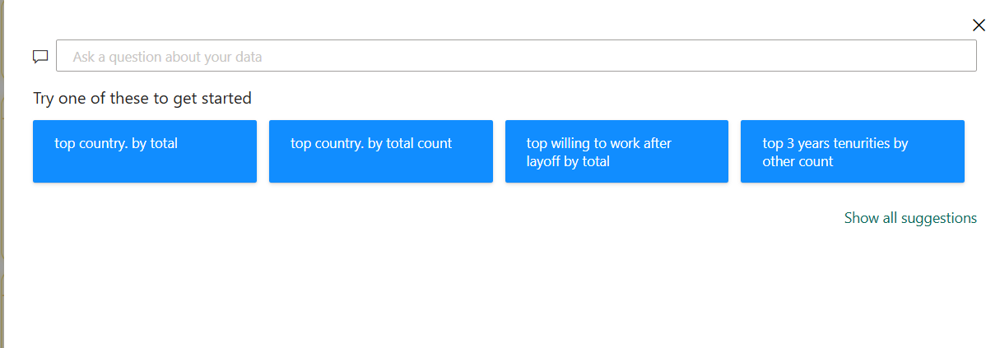

# 📊 Career Aspirations of Gen Z | Power BI Dashboard

**An interactive, multi-page Power BI dashboard exploring Gen Z's career aspirations, salary expectations, leadership preferences, workplace choices, and learning trends.**

## 📌 Project Overview

This project analyzes **65,039 responses** to understand Gen Z's career goals, expectations from managers and employers, salary preferences, and preferred learning environments.

Developed using Microsoft Power BI, the report contains three interconnected dashboard pages: **Mission Aspirations, Manager Aspirations, and Learning Aspirations**. It combines interactive visualizations, KPI cards, slicers, custom navigation buttons, bookmarks, and Power BI Q&A to make data exploration easier.

## 🎯 Business Objectives

- **Understand Career Aspirations:** Identify popular job preferences and the factors influencing Gen Z's career choices.
- **Analyze Salary Expectations:** Explore expected starting salaries and salary expectations after three years of experience.
- **Evaluate Mission Alignment:** Understand respondents' willingness to work for companies with different mission-alignment categories.
- **Identify Leadership Preferences:** Analyze the manager qualities and workplace cultures preferred by Gen Z.
- **Explore Workplace Preferences:** Examine preferred team sizes, working hours, and willingness to stay with an employer.
- **Understand Learning Trends:** Compare preferred learning environments, vacation periods, and higher-education preferences.
- **Enable Interactive Analysis:** Allow users to explore results using year and gender slicers and navigate between report pages.

## 📷 Dashboard Preview

### 1. Mission Aspirations

This page explores salary expectations, company mission alignment, and selected workplace-related preferences.

**Key insights:**
- The most common salary expectation for three years of experience is **above 50K**, with 19,980 responses.
- The dashboard shows 18,276 responses in the undefined-mission category.
- The mission-related visuals compare willingness to work for companies with different mission-alignment categories.
- Salary expectations can be explored alongside mission-related responses.

### 2. Manager Aspirations

This page analyzes preferred manager qualities, workplace setup, employer culture, and leadership expectations.

**Key insights:**
- A **well-explaining manager** is the leading preference, with 29,048 responses.
- Supportive managers rank next, with 18,868 responses.
- Working with a team of 5–6 people is the most selected workplace setup shown, with 20,762 responses.
- Additional visuals examine attitudes toward abusive managers and the relationship between manager preferences and employer culture.

### 3. Learning Aspirations

This page examines desired job designations, higher education, working hours, vacation preferences, and learning environments.

**Key insights:**
- **Manager** is the most selected desired job designation, with 6,553 responses.
- Parents are the leading influence on career choice in the displayed results, with 21,870 responses.
- Learning through an instructor is the leading learning environment shown, with 15,012 responses.
- Self-paced learning and learning by observing are also popular choices.
- The report compares preferences for working hours, vacation periods, and higher education abroad.

## 🧭 Interactive Navigation & User Experience

A key feature of this project is its custom navigation system, designed to make the three-page report easier to explore.

### 1. Custom Navigation Menu — Buttons & Bookmarks

The report includes a custom navigation panel that lets users move between dashboard pages.

**How it works:**
1. Click the **three-line menu (☰)** to open the navigation panel.
2. Select **Mission Aspirations**, **Manager Aspirations**, or **Learning Aspirations**.
3. The corresponding dashboard page opens.
4. The navigation menu can be shown or hidden using the report's custom controls.

Buttons and bookmarks support the menu's visibility and navigation experience, helping maintain a consistent layout across pages.

### 2. Power BI Q&A — Ask Questions About the Data

The report includes a **Power BI Q&A feature** that enables users to explore the dataset using natural-language questions and suggested queries. This allows users to investigate key trends without manually creating every visual.

**Example questions and analyses include:**
- Identify the country with the highest total respondent count.
- Explore respondent counts for selected categories.
- Analyze willingness to work after a layoff.
- Examine three-year tenure preferences.

This feature supports exploratory data analysis by helping users discover patterns, investigate specific topics, and gain insights more efficiently.
### 3. Information Panel

The dashboard includes an **Information Panel**, accessible through the information icon in the report navigation area. It provides users with access to supporting information while exploring the report.

Together with the custom navigation menu and Q&A feature, this element contributes to a more guided and user-friendly reporting experience.
### 4. Interactive Slicers

The report includes **year and gender slicers** that allow users to filter the displayed results and compare responses across selected groups. The visuals update according to the applied selections.

## 🔍 Key Analytical Areas

| Analytical Area | What It Explores |
|---|---|
| Career Aspirations | Desired job roles and influences on career choices |
| Salary Expectations | Expected starting salaries and salaries after three years |
| Mission Alignment | Willingness to work for companies with different mission categories |
| Manager Preferences | Preferred manager qualities and leadership expectations |
| Workplace Choices | Team setup, working hours, and employer tenure |
| Learning Aspirations | Learning environments, vacation periods, and higher education |

## 🛠️ Tools & Technologies

| Technology / Skill | Application |
|---|---|
| Microsoft Power BI | Dashboard development and report design |
| DAX Measures | KPI calculations and analytical measures |
| Data Visualization | Bar charts, line charts, pie charts, and KPI cards |
| Interactive Slicers | Year and gender-based filtering |
| Buttons & Bookmarks | Custom navigation and menu visibility |
| Power BI Q&A | Natural-language data exploration |
| Data Analysis | Identifying trends and comparing response patterns |
| Dashboard Design | Multi-page layout and user experience |

## 💡 Business Value

This dashboard converts survey responses into an interactive view of Gen Z's career and workplace expectations. It helps users:

- Identify popular career and learning preferences.
- Understand salary expectations and workplace priorities.
- Compare preferred leadership qualities and employer cultures.
- Explore differences across selected years and gender groups.
- Navigate between related analytical views in a single report.

## 📂 Repository Contents

| File | Description |
|---|---|
| `Career Aspiration of GEN-Z.pbix` | Interactive Power BI report |
| `Mission Aspiration.png` | Mission Aspirations dashboard preview |
| `Manager Aspirations.png` | Manager Aspirations dashboard preview |
| `Learning Aspirations.png` | Learning Aspirations dashboard preview |
| `Three Lines.png` | Custom navigation menu preview |
| `QNA.png` | Power BI Q&A preview |
| `Info.png` | Information panel preview |
| `README.md` | Project documentation |

## 📥 Download the Power BI Dashboard

[**Download Career Aspirations of Gen Z (.pbix)**](https://github.com/vansh02nagpal-ux/Career-Aspirations-of-GEN-Z/raw/refs/heads/main/Career%20Aspiration%20of%20GEN-Z.pbix)

Download the `.pbix` file and open it in Microsoft Power BI Desktop to explore the interactive pages, apply slicers, use the navigation menu, and try the available features.

## 👤 Author

**Vansh Nagpal**  
Aspiring Data Analyst

**Skills:** Power BI | DAX | SQL | Microsoft Excel | Python | Data Visualization

[GitHub Profile](https://github.com/vansh02nagpal-ux)
